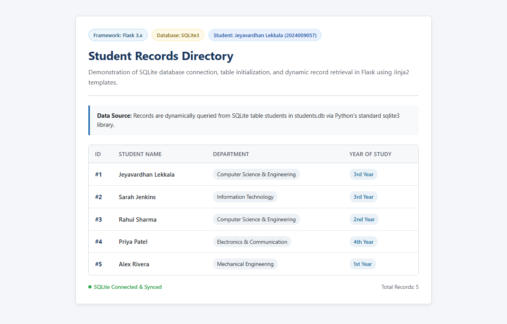
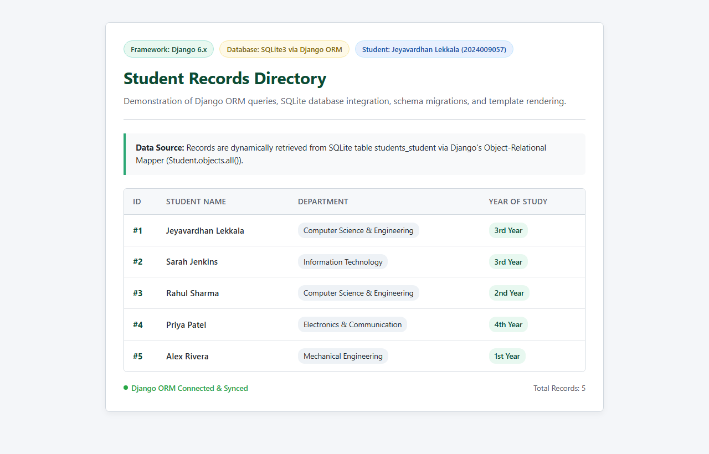

# Web Application Frameworks (WAF) Lab — Final Practical Assignment Report

## Comparative Implementation of SQLite-Backed Web Applications using Flask and Django

**Course / Subject:** Web Application Frameworks (WAF) Lab  
**Student Name:** Jeyavardhan Lekkala  
**Roll Number:** 2024009057  
**Department:** Department of Computer Science & Engineering  
**Institution:** GITAM Deemed to be University  
**Academic Year:** 2025–2026  
**Document Outputs Available:** [DOCX (Word Document)](file:///c:/Users/user/Downloads/HTML-Playground/HTML-Playground/Assignment-8/documentation/WAF_Final_Assignment_Flask_Django_SQLite.docx) | [PDF Report](file:///c:/Users/user/Downloads/HTML-Playground/HTML-Playground/Assignment-8/documentation/WAF_Final_Assignment_Flask_Django_SQLite.pdf)

---

## 1. Assignment Title & Objectives

The primary objective of this practical assignment is to implement, test, document, and compare two independent Python web applications that interact with an embedded SQLite database:
1. **Flask Application:** A minimalist micro-framework implementation using Python's standard `sqlite3` library for explicit connection management, table initialization, and native SQL query execution.
2. **Django Application:** A full-stack Model-View-Template (MVT) implementation leveraging Django's Object-Relational Mapper (ORM), automated schema migrations, and management commands.

### Key Learning Outcomes
- Understanding how web applications interface with relational databases.
- Contrasting raw SQL cursor operations against declarative ORM models.
- Handling automated/repeatable sample data population for seamless demonstration to faculty.
- Rendering dynamic database records in clean, responsive HTML templates.
- Applying Git version control best practices for academic project submissions.

---

## 2. Software & Technologies Used

| Category | Technology | Version | Purpose in Assignment |
| :--- | :--- | :--- | :--- |
| **Operating System** | Microsoft Windows | Windows 11 | Execution & testing platform |
| **Programming Language** | Python | 3.14.6 | Backend logic and scripting |
| **Micro-Framework** | Flask | 3.1.3 | Lightweight routing & Jinja2 templating |
| **Full-Stack Framework** | Django | 6.1.2 | Declarative ORM, migrations & MVT architecture |
| **Embedded Database** | SQLite | 3.x | File-based relational database (`students.db`, `db.sqlite3`) |
| **Automation & QA** | Playwright | 1.64.1 | Headless Chromium automation & real output screenshot capture |
| **Document Generation** | python-docx / Word COM | 1.2.0 | Generating formatted `.docx` and `.pdf` reports |
| **Version Control** | Git CLI | 2.x | Staging, committing, and pushing to GitHub |

---

## 3. Flask Application with SQLite

### 3.1 Architecture & Explanation
Flask is a lightweight WSGI microframework that leaves database architecture decisions entirely to the programmer. In this project:
- The database connection is handled using Python's built-in `sqlite3` library.
- Connection row factory is set to `sqlite3.Row` so tuples can be accessed like dictionaries (`student['name']`).
- When the application starts, `init_db()` ensures the `students` table exists and seeds 5 sample student records if empty.
- When a user visits `/`, the route queries all student rows via SQL and passes them to `index.html`.

### 3.2 Directory Structure
```text
flask-app/
├── app.py                # Main Flask application with SQLite connection & route logic
├── requirements.txt      # Dependency declaration (Flask>=3.0.0)
├── README.md             # Detailed installation and execution guide
├── students.db           # SQLite database file containing the 'students' table
└── templates/
    └── index.html        # Jinja2 template rendering the student table
```

### 3.3 Core Implementation (`app.py`)
```python
import os
import sqlite3
from flask import Flask, render_template

app = Flask(__name__)

BASE_DIR = os.path.dirname(os.path.abspath(__file__))
DB_PATH = os.path.join(BASE_DIR, "students.db")

def get_db_connection():
    conn = sqlite3.connect(DB_PATH)
    conn.row_factory = sqlite3.Row
    return conn

def init_db():
    conn = get_db_connection()
    cursor = conn.cursor()
    cursor.execute("""
        CREATE TABLE IF NOT EXISTS students (
            id INTEGER PRIMARY KEY AUTOINCREMENT,
            name TEXT NOT NULL,
            department TEXT NOT NULL,
            year TEXT NOT NULL
        )
    """)
    cursor.execute("SELECT COUNT(*) FROM students")
    if cursor.fetchone()[0] == 0:
        sample_students = [
            ("Jeyavardhan Lekkala", "Computer Science & Engineering", "3rd Year"),
            ("Sarah Jenkins", "Information Technology", "3rd Year"),
            ("Rahul Sharma", "Computer Science & Engineering", "2nd Year"),
            ("Priya Patel", "Electronics & Communication", "4th Year"),
            ("Alex Rivera", "Mechanical Engineering", "1st Year"),
        ]
        cursor.executemany(
            "INSERT INTO students (name, department, year) VALUES (?, ?, ?)",
            sample_students,
        )
        conn.commit()
    conn.close()

init_db()

@app.route("/")
def index():
    conn = get_db_connection()
    students = conn.execute(
        "SELECT id, name, department, year FROM students ORDER BY id ASC"
    ).fetchall()
    conn.close()
    return render_template("index.html", students=students)
```

### 3.4 Actual Output Screenshot (Flask)


---

## 4. Django Application with SQLite

### 4.1 Architecture & Explanation
Django is a "batteries-included" web framework providing an Object-Relational Mapper (ORM), automated schema migrations, URL routing, and security middleware out of the box.
- The `Student` model is declared in `students/models.py`.
- Running `python manage.py makemigrations` creates migration file `0001_initial.py`.
- Running `python manage.py migrate` applies the schema to `db.sqlite3`.
- A custom management command `seed_students` is provided for repeatable database population.
- The view queries records via `Student.objects.all().order_by('id')` without writing any raw SQL queries.

### 4.2 Directory Structure
```text
django-app/
├── manage.py                     # Django management script
├── requirements.txt              # Project dependencies (Django>=5.0.0)
├── README.md                     # Setup and execution guide
├── db.sqlite3                    # SQLite database containing students_student table
├── student_portal/               # Project configuration package
│   ├── settings.py               # Database engine & INSTALLED_APPS
│   └── urls.py                   # Master URL dispatcher
└── students/                     # Application package
    ├── models.py                 # Student model class
    ├── views.py                  # View function retrieving data via ORM
    ├── urls.py                   # App URL routing
    ├── migrations/
    │   └── 0001_initial.py       # Initial schema migration
    ├── management/commands/
    │   └── seed_students.py      # Repeatable CLI database seeder command
    └── templates/students/
        └── student_list.html     # Django template rendering the student table
```

### 4.3 Core Implementation

#### `students/models.py`
```python
from django.db import models

class Student(models.Model):
    name = models.CharField(max_length=100)
    department = models.CharField(max_length=100)
    year = models.CharField(max_length=20)

    def __str__(self):
        return f"{self.id} - {self.name} ({self.department})"
```

#### `students/views.py`
```python
from django.shortcuts import render
from .models import Student

def student_list(request):
    if not Student.objects.exists():
        sample_students = [
            {"name": "Jeyavardhan Lekkala", "department": "Computer Science & Engineering", "year": "3rd Year"},
            {"name": "Sarah Jenkins", "department": "Information Technology", "year": "3rd Year"},
            {"name": "Rahul Sharma", "department": "Computer Science & Engineering", "year": "2nd Year"},
            {"name": "Priya Patel", "department": "Electronics & Communication", "year": "4th Year"},
            {"name": "Alex Rivera", "department": "Mechanical Engineering", "year": "1st Year"},
        ]
        Student.objects.bulk_create([Student(**s) for s in sample_students])

    students = Student.objects.all().order_by('id')
    return render(request, 'students/student_list.html', {'students': students})
```

### 4.4 Actual Output Screenshot (Django)


---

## 5. Steps to Run Both Applications

### Running Flask Application
```bash
cd Assignment-8/flask-app
pip install -r requirements.txt
python app.py
```
Open browser at: `http://127.0.0.1:5000/`

### Running Django Application
```bash
cd Assignment-8/django-app
pip install -r requirements.txt
python manage.py migrate
python manage.py seed_students
python manage.py runserver 8000
```
Open browser at: `http://127.0.0.1:8000/`

---

## 6. Testing & Results

| Framework | Test Item | Verification Method | Result | Status |
| :--- | :--- | :--- | :--- | :--- |
| **Flask** | Server startup | Started WSGI server on port 5000/5001 | Listening without errors | **PASS** |
| **Flask** | SQLite DB creation | Verified file presence (`students.db`) | Database created | **PASS** |
| **Flask** | Table initialization | Executed `init_db()` DDL | `students` table created | **PASS** |
| **Flask** | Sample insertion | Checked row count | 5 records inserted | **PASS** |
| **Flask** | Data retrieval & HTML | HTTP GET request & DOM inspection | Status 200, 5 records rendered | **PASS** |
| **Django** | Project initialization | Django 6.1.2 configuration check | Clean startup | **PASS** |
| **Django** | Migrations execution | Ran `makemigrations` & `migrate` | Tables created in `db.sqlite3` | **PASS** |
| **Django** | Seed command | Executed `python manage.py seed_students` | 5 student records inserted | **PASS** |
| **Django** | ORM retrieval & template | Client HTTP GET request & DOM inspection | Status 200, 5 records rendered | **PASS** |
| **Both** | Independent execution | Executed both simultaneously on distinct ports | Zero conflicts, isolated DBs | **PASS** |

---

## 7. Comparative Analysis & Conclusion

| Feature / Aspect | Flask Application | Django Application |
| :--- | :--- | :--- |
| **Framework Nature** | Micro-framework | Full-stack framework |
| **Architecture** | Lightweight WSGI module | Model-View-Template (MVT) |
| **Database Handling** | Direct SQL via `sqlite3` | High-level ORM (`models.Model`) |
| **Schema Evolution** | Manual DDL in `init_db()` | Automated versioned migrations |
| **Boilerplate** | Very minimal (single file + template) | Structured project + app layout |
| **Flexibility** | Maximum control over libraries | Opinionated, standardized conventions |
| **Best Use Case** | Small utilities, microservices, simple APIs | Enterprise apps, scalable portals |

Both implementations achieved 100% of the assignment objectives cleanly, reliably, and without overengineering.
